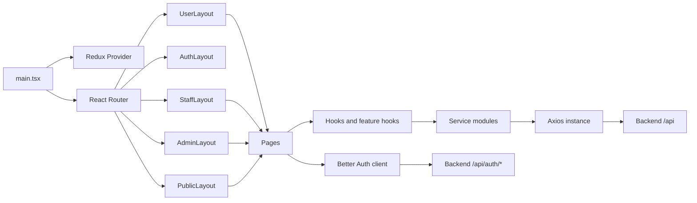

# Flyx — Private Jet Travel Platform (Frontend)

A React + TypeScript single-page application for the Flyx shared private-charter membership platform. It includes the public marketing site, authentication flow, and role-based dashboards for members, staff, and administrators.

> Project status: in development. Several dashboard screens are implemented with local/mock data and are ready to be connected to backend APIs.

## Project Description

Flyx makes private jet travel more accessible by letting members share charter flights on popular routes. This repository is the frontend application: a responsive React SPA that presents the membership experience and provides separate dashboards for travelers, concierge staff, and administrators.

The app is built with React 19, Vite, TypeScript, Tailwind CSS v4, React Router v8, Redux Toolkit, Axios, Better Auth, and Recharts.

## Project Overview

Private aviation is expensive for a single traveler. Flyx collects travel demand, groups members heading in the same direction, and presents shared charter opportunities. The frontend supports that workflow from first visit through reservation and staff trip coordination.

Primary journeys:

1. A visitor explores the public home, membership, FAQ, contact, and terms pages.
2. A visitor registers with profile details and an optional profile photo. The registration screen presents a $199 registration fee; payment is not integrated yet.
3. A member signs in and is redirected to the dashboard for their role.
4. A member submits recurring or one-time travel preferences and detailed custom travel requests.
5. Staff review demand, manage travel preferences and custom requests, and publish opportunities.
6. A member browses open opportunities, reserves a seat, and cancels before confirmation if needed.
7. Confirmed trips appear in the member's upcoming trips and dashboard.
8. An admin monitors member activity, manages the member directory, and creates or removes concierge staff accounts.

Role-based routes:

| Route group | Layout | Access |
| --- | --- | --- |
| `/`, `/membership`, `/contact`, `/faq`, `/terms` | `PublicLayout` | Everyone |
| `/login`, `/register` | `AuthLayout` | Guests; authenticated users are redirected to their dashboard |
| `/user/*` | `UserLayout` | Role `user` |
| `/staff/*` | `StaffLayout` | Role `staff` |
| `/admin/*` | `AdminLayout` | Role `admin` |

## Live Demo

A public deployment URL is not committed in this repository. Vercel SPA configuration and Vercel project metadata for `flyx-travel-platform` are present, so the app is ready to deploy.

| Environment | URL |
| --- | --- |
| Local frontend | `http://localhost:5173` |
| Local backend | `http://localhost:5000` |
| Local API base | `http://localhost:5000/api` |
| Production frontend | Not published in the repository yet |

After deployment, update `VITE_API_URL` and `VITE_API_URI` to the public backend URL, and set the backend's `CLIENT_URL` to the deployed frontend origin.

## Screenshots / Preview

The repository currently contains the original UI design assets rather than captured screenshots of the running pages. The assets below are used directly by the application. Replace them with full application screenshots after the next deployment.

| Public homepage hero | Membership visual | Authentication visual |
| --- | --- | --- |
|  |  |  |

| Brand mark | Contact page hero | Travel visual |
| --- | --- | --- |
|  |  |  |

## Key Features

### Public site

- Responsive public layout with brand navigation and footer.
- Home page with hero, how-it-works, curated travel, premium benefits, private aviation, FAQ, and call-to-action sections.
- Membership page explaining the shared charter model, pricing logic, flight operations, and member benefits.
- FAQ page with an accordion list.
- Contact page with contact methods, social links, phone/WhatsApp links, and a contact form that currently composes an email through `mailto:`.
- Terms and conditions page.
- Dark/light theme support through CSS variables and a Redux theme slice.

### Authentication

- Email/password login and registration using Better Auth's React client.
- Registration captures first name, last name, address, ZIP code, city, state, phone, email, password, and confirmation.
- Optional profile photo upload to ImgBB before account creation.
- Session-aware redirects: authenticated users are sent to their role dashboard; guests are sent to login when opening protected routes.
- Logout clears the Better Auth session and returns to `/login`.

### Member dashboard

- Overview with summary cards, quick actions, demand insights, and upcoming trips.
- Travel opportunities with URL-based status/type filters, pagination, loading skeletons, empty/error states, seat reservation, and reservation cancellation.
- Pending reservations view.
- Upcoming trips view for confirmed opportunities.
- Travel preferences with separate recurring and one-time forms, saved preference list, and delete confirmation.
- New custom travel request form with one-way/round-trip toggle, passenger counter, dynamic passenger rows, validation, and success state.
- My custom travel requests list with status display.
- Inbox, notifications, and profile settings screens. These currently use local/mock data and are ready for API integration.

### Staff dashboard

- Staff overview combining analytics insights and the demand calendar.
- Demand calendar with month navigation, per-day member counts, and day detail views.
- Members interest management with filtering, request details, status updates, and deletion.
- Opportunity management with filters, pagination, status badges, status transitions, and opportunity details.
- New opportunity form for one-way and two-way charters, including aircraft, capacity, price, and draft/open publishing.
- Travel management for recurring and one-time preferences, with direction/status filters, detail modals, and status changes.
- Staff inbox and profile screens.

### Admin dashboard

- Admin overview with member/staff totals, interest this month, revenue, members-over-time chart, daily activity chart, monthly demand, and popular routes.
- Member directory with pagination, detailed member view, and editable personal information.
- Concierge staff management: list, paginate, create, and delete staff accounts.
- Profile/settings screen.

### UX and engineering

- Route-level role guards for `/user`, `/staff`, and `/admin`.
- Responsive dashboard sidebar with mobile drawer and desktop collapse mode.
- Tailwind CSS v4 theme tokens for colors, typography, containers, and dark mode.
- Reusable UI components for cards, badges, modals, form fields, pagination, skeletons, and charts.
- Abortable data fetching through a custom `useFetch` hook.
- Axios request interceptor that attaches the Better Auth JWT to every REST call.
- Centralized error normalization from API responses.
- Recharts-powered admin charts and progress-bar demand visualizations.
- Accessible labels, focus styles, keyboard `Escape` handling in modals, and reduced visual clutter on small screens.

## Technologies Used

| Technology | Version / Role |
| --- | --- |
| React | `^19.3.1` |
| React DOM | `^19.3.1` |
| TypeScript | `~6.0.3` |
| Vite | `^8.3.6` |
| React Router | `^8.5.1` |
| Tailwind CSS | `^4.3.5` with `@tailwindcss/vite` |
| Redux Toolkit | `^2.14.0` |
| React Redux | `^9.3.1` |
| Axios | `^1.21.1` |
| Better Auth | `^1.7.26` |
| Recharts | `^3.11.0` |
| Lucide React | `^1.71.0` |
| ESLint | `^10.14.0` with TypeScript ESLint and React Hooks plugins |

No component library such as HeroUI is used; the UI is built from local components and Lucide icons.

## Project Architecture

The frontend is a client-rendered SPA with domain-oriented route groups:



Key architectural decisions:

- `src/routes/router.tsx` defines public, auth, user, staff, and admin route trees.
- `src/layouts/*` provide shared shells and role guards. A signed-in user who opens another role's area is redirected to their own dashboard.
- `src/pages/*` contains route-level screens grouped by audience.
- `src/components/*` contains reusable and audience-specific UI.
- `src/services/*` contains REST modules for opportunities, travel preferences, custom travel, and calendar data.
- `src/features/*` contains feature-scoped API modules, types, hooks, and utilities for dashboard and analytics.
- `src/hooks/*` contains data-fetching hooks and session helpers.
- `src/lib/axios.ts` creates the API client, attaches the JWT, and normalizes errors.
- `src/lib/auth-client.ts` configures Better Auth with the JWT client plugin and additional profile fields.
- `src/store/*` currently manages only the theme slice. Server data is fetched per screen rather than stored in Redux.
- `src/index.css` defines Tailwind v4 theme tokens and shared utilities.
- `src/utils/*` contains formatting, date/calendar, travel, opportunity, image upload, and auth helpers.

The application expects the backend API described in [`../Backend/README.md`](../Backend/README.md).

## Project Structure

```text
frontend/
├── public/
│   ├── favicon.svg
│   └── icons.svg
├── src/
│   ├── assets/
│   │   ├── images/                    # Hero, membership, auth, and brand assets
│   │   ├── hero.png
│   │   ├── react.svg
│   │   └── vite.svg
│   ├── components/
│   │   ├── admin/                     # Admin stat cards, charts, skeleton
│   │   ├── calendar/                  # Demand calendar and travel detail modals
│   │   ├── custom-travel/             # Custom request form pieces
│   │   ├── Opprotunites/              # Opportunities and reservations UI
│   │   ├── public/                    # Marketing and contact sections
│   │   ├── shared/                    # Navbar, footer, CTA, dashboard sidebar
│   │   ├── staff/                     # Staff status badges, menus, confirm modal
│   │   ├── travel/                    # Travel preference forms and rows
│   │   ├── ui/                        # Generic badges, cards, fields, pagination
│   │   └── user/                      # Member dashboard pieces
│   ├── data/                          # Static dashboard navigation and FAQ data
│   ├── features/
│   │   ├── analytics/                 # Staff/admin analytics API, types, hooks
│   │   └── dashboard/                 # Member dashboard API, types, hooks
│   ├── hooks/                         # useFetch, useCurrentUser, domain hooks
│   ├── layouts/                       # PublicLayout, AuthLayout, role layouts
│   ├── lib/                           # axios, Better Auth client, utils
│   ├── pages/
│   │   ├── admin/                     # Admin overview, members, concierge
│   │   ├── auth/                      # Login and register
│   │   ├── public/                    # Home, membership, contact, FAQ, terms
│   │   ├── staff/                     # Staff overview and management pages
│   │   ├── users/                     # Member dashboard pages
│   │   ├── AnalyticsPage.tsx
│   │   ├── InboxPage.tsx
│   │   ├── NotificationsPage.tsx
│   │   └── ProfileSettingsPage.tsx
│   ├── routes/
│   │   └── router.tsx                 # Route tree and role areas
│   ├── services/                      # REST API modules
│   ├── store/                         # Redux store and theme slice
│   ├── types/                         # Shared TypeScript types
│   ├── utils/                         # Formatting, calendar, auth, image helpers
│   ├── index.css                      # Tailwind theme and global styles
│   └── main.tsx                       # React entry point
├── dist/                              # Production build output (generated)
├── eslint.config.js
├── index.html
├── package.json
├── tsconfig.app.json
├── tsconfig.json
├── tsconfig.node.json
├── vercel.json                        # SPA rewrite for Vercel
├── vite.config.ts                     # React, Tailwind, and @ alias
└── README.md
```

> Note: the opportunities component folder is spelled `Opprotunites` in the current repository. Keep that spelling when importing from it unless the folder is renamed intentionally.

## Installation & Setup

### Prerequisites

- Node.js 20 or newer.
- npm.
- A running Flyx backend (see the backend README).
- Optional: an ImgBB API key if you want profile-photo uploads during registration.

### Steps

1. Open the frontend directory.

   ```bash
   cd frontend
   ```

2. Install dependencies.

   ```bash
   npm install
   ```

3. Create a `.env` file in the frontend root. The included `.env.example` is currently empty, so use the variable table below.

4. Start the backend first so the API and Better Auth endpoints are available.

   ```bash
   cd ../Backend
   npm run dev
   ```

5. Start the frontend in another terminal.

   ```bash
   cd frontend
   npm run dev
   ```

6. Open `http://localhost:5173`.

## Environment Variables

Create `frontend/.env` with:

| Variable | Required | Description |
| --- | --- | --- |
| `VITE_API_URL` | Yes | Backend origin without `/api`, used by Better Auth. Example: `http://localhost:5000`. |
| `VITE_API_URI` | Yes | REST API base including `/api`. Example: `http://localhost:5000/api`. |
| `VITE_IMG_BB_API_URI` | For photo upload | ImgBB API key used by `src/utils/image.util.ts`. The variable name says `URI`, but the code treats it as the API key. |

Example:

```dotenv
VITE_API_URL=http://localhost:5000
VITE_API_URI=http://localhost:5000/api
VITE_IMG_BB_API_URI=your_imgbb_api_key
```

Notes:

- `VITE_API_URL` and `VITE_API_URI` are intentionally different: Better Auth is mounted at the origin, while REST calls go to `/api`.
- Every `VITE_*` variable is embedded in the browser bundle. Do not put private server secrets in a `VITE_*` variable.
- After changing `.env`, restart the Vite dev server.
- For production, set the backend's `CLIENT_URL` to the deployed frontend origin and use HTTPS. Better Auth is configured with secure, cross-site cookies.

## Run Locally

| Command | What it does |
| --- | --- |
| `npm run dev` | Starts the Vite development server. |
| `npm run lint` | Runs ESLint over the project. |
| `npm run typecheck` | Runs TypeScript build checking with `tsc -b`. |
| `npm run build` | Type-checks and creates a production build in `dist/`. |
| `npm run preview` | Serves the production build locally. |

Local URLs:

- Frontend: `http://localhost:5173`
- Backend API: `http://localhost:5000/api`
- Better Auth: `http://localhost:5000/api/auth/*`

If the browser blocks API requests, confirm:

1. The backend is running on the expected port.
2. `VITE_API_URL` and `VITE_API_URI` point to the same backend.
3. The backend's `CLIENT_URL` exactly matches the frontend origin, including protocol and port.
4. The backend is reachable over HTTPS when deployed, because of the secure cookie configuration.

## API Documentation

The frontend consumes the Flyx REST API. Full request/response documentation is in [`../Backend/README.md`](../Backend/README.md).

### Base URL and authentication

- REST base: `VITE_API_URI` (for example `http://localhost:5000/api`).
- Auth base: `VITE_API_URL` (for example `http://localhost:5000`).
- All REST calls use the shared Axios instance in `src/lib/axios.ts`.
- The request interceptor obtains a JWT with `authClient.token()` and sends `Authorization: Bearer <JWT>`.
- `withCredentials: true` is enabled for Better Auth session cookies.
- API errors are normalized into `Error` objects with the backend `message`.

### Endpoints used by the frontend

| Area | Endpoints | Frontend module |
| --- | --- | --- |
| Auth | `/api/auth/sign-up/email`, `/api/auth/sign-in/email`, `/api/auth/get-session`, `/api/auth/token`, `/api/auth/sign-out` | `src/lib/auth-client.ts`, `src/utils/auth.util.ts`, `src/utils/get.token.util.ts` |
| Dashboard | `GET /api/dashboard/overview` | `src/features/dashboard/dashboard.api.ts` |
| Opportunities (member) | `GET /api/opportunities`, `GET /api/opportunities/my`, `POST /api/opportunities/:id/reserve`, `DELETE /api/opportunities/:id/reserve` | `src/services/opportunity.service.ts` |
| Opportunities (staff/admin) | `GET /api/opportunities/manage`, `GET /api/opportunities/manage/:id`, `POST /api/opportunities`, `PATCH /api/opportunities/:id/status` | `src/services/opportunity-manage.service.ts` |
| Travel preferences (member) | `POST /api/travel`, `GET /api/travel/me`, `DELETE /api/travel/:id` | `src/services/travel.api.ts` |
| Travel preferences (staff/admin) | `GET /api/travel/manage`, `GET /api/travel/manage/directions`, `GET /api/travel/manage/:id`, `PATCH /api/travel/manage/:id/status` | `src/services/travel-manage.service.ts` |
| Custom travel (member) | `POST /api/custom-travel`, `GET /api/custom-travel/me` | `src/services/custom-travel.api.ts` |
| Custom travel (staff/admin) | `GET /api/custom-travel`, `GET /api/custom-travel/:id`, `PATCH /api/custom-travel/:id/status`, `DELETE /api/custom-travel/:id` | `src/services/custom-travel.service.ts` |
| Custom travel calendar | `GET /api/custom-travel/calendar?from=&to=`, `GET /api/custom-travel/calendar/:date` | `src/services/custom-travel-calendar.service.ts` |
| Analytics | `GET /api/analytics/insights`, `GET /api/analytics/admin-overview?year=` | `src/features/analytics/analytics.api.ts` |
| Members and staff (admin) | `GET /api/users`, `PATCH /api/users/:id`, `GET /api/users/staff`, `POST /api/users/staff`, `DELETE /api/users/staff/:id` | Direct calls in `src/pages/admin/*` |
| Health | `GET /api/health` | Available for smoke testing |

### Response conventions

Successful responses generally follow:

```json
{
  "success": true,
  "data": {}
}
```

List endpoints add pagination metadata:

```json
{
  "success": true,
  "data": [],
  "meta": {
    "page": 1,
    "limit": 10,
    "total": 0,
    "totalPages": 0,
    "hasNextPage": false,
    "hasPrevPage": false
  }
}
```

Errors follow:

```json
{
  "success": false,
  "message": "Something went wrong"
}
```

Status handling in the UI:

- `401` should send the user back to login or refresh the Better Auth session.
- `403` means the role is not allowed to perform the action.
- `404` is shown as a not-found/empty state where applicable.
- `409` is used for conflicts such as duplicate reservations or no available seats.

## Authentication & Authorization

### Authentication flow

1. `src/lib/auth-client.ts` creates the Better Auth React client with:
   - `baseURL: VITE_API_URL`
   - `credentials: "include"`
   - `inferAdditionalFields` for the profile fields
   - `jwtClient()` for token access
2. Registration calls `authClient.signUp.email()` with the profile data and optional ImgBB image URL.
3. Login calls `authClient.signIn.email()`.
4. After sign-in or sign-up, the app waits for the session store to expose the user before navigating.
5. `useCurrentUser()` wraps `authClient.useSession()` and returns the user, role, and pending state.
6. `src/utils/get.token.util.ts` calls `authClient.token()` for each REST request. The Axios interceptor attaches the resulting JWT as a Bearer token.
7. Logout calls `authClient.signOut()` and navigates to `/login`.

### Authorization flow

- `UserLayout` requires a session and role `user`.
- `StaffLayout` requires a session and role `staff`.
- `AdminLayout` requires a session and role `admin`.
- If a signed-in user opens another role's area, they are redirected to `/<their-role>`.
- If no session exists, protected routes redirect to `/login`.
- Public routes remain accessible to everyone, including signed-in users.
- The frontend guards improve navigation, but the backend enforces real security on every protected endpoint.

### Role redirects

| After login/sign-up | Destination |
| --- | --- |
| Role `user` | `/user` |
| Role `staff` | `/staff` |
| Role `admin` | `/admin` |

## Testing

Automated tests are not configured yet. There is no test runner or test script in `package.json`.

Available checks:

```bash
npm run lint
npm run typecheck
npm run build
```

Manual QA checklist:

1. Start the backend and frontend, then open `/`.
2. Verify the public pages load and the theme toggle works.
3. Register a new member and confirm the role-based redirect to `/user`.
4. Refresh the page and confirm the session persists.
5. Open `/user/travel-opportunities` and test status/type filters and pagination.
6. Reserve a seat and verify the opportunity appears in pending reservations.
7. Cancel a pending reservation and verify it disappears.
8. Submit recurring and one-time travel preferences, then delete one.
9. Submit a one-way and a two-way custom travel request with multiple passengers.
10. Open `/staff` with a staff account and verify analytics, calendar, members interest, opportunities, and travel management.
11. Create an opportunity as staff, publish it as open, and verify it appears for members.
12. Open `/admin` with an admin account and verify charts, member editing, and staff creation/deletion.
13. Try opening `/admin` as a member and confirm the redirect to `/user`.
14. Test the sidebar on mobile and desktop widths.
15. Verify modern browser console output contains no blocking errors.

## Future Improvements

- Connect profile settings, inbox, and notifications to real backend endpoints (these screens currently use local/mock data).
- Integrate a payment provider for the registration fee and charter payments.
- Add real-time reservation, notification, and messaging updates.
- Add automated tests with Vitest and React Testing Library, plus end-to-end tests with Playwright or Cypress.
- Add route-level code splitting with `React.lazy` and Suspense.
- Add a proper 404 page and route-level error boundaries.
- Add SEO metadata, social preview images, and a real page title (the current `index.html` title is `frontend`).
- Add stronger client-side form validation with a shared schema.
- Add pagination and filters to members interest and custom travel lists where missing.
- Add the missing `/api/opportunities/directions` endpoint on the backend or remove the unused client call.
- Replace design-asset previews in this README with real application screenshots.
- Improve accessibility coverage for charts, modals, focus trapping, and keyboard navigation.
- Add image optimization and responsive image variants.
- Add a consistent design-token layer for spacing and chart colors.
- Add internationalization if the platform expands beyond its current market.
- Add CI checks for lint, typecheck, and build.

## Contributing

Contributions are welcome.

1. Create a branch for your change.
2. Keep the existing route-group and layout structure.
3. Reuse existing components, hooks, and service modules instead of adding parallel patterns.
4. Follow the existing Tailwind theme tokens and dark-mode conventions.
5. Do not commit `.env` files, API keys, tokens, or other secrets.
6. Run `npm run lint`, `npm run typecheck`, and `npm run build` before opening a pull request.
7. Include screenshots or a short recording for visible UI changes.
8. Describe any API contract changes and link to the corresponding backend change.
9. Update this README when routes, environment variables, or setup steps change.

For large features, open an issue or discussion first so the UX and API contract can be aligned.

## License

No license file is included in this frontend repository and `package.json` does not declare a license. The backend package declares **ISC**. The public footer states "© Flyx Aviation. All rights reserved."

Before distributing or deploying this project publicly, choose and document a license for the frontend and add the corresponding `LICENSE` file.

## Author / Contact Information

**Flyx Aviation — Frontend**

- Maintainer: Rahim (`rahimsoftdev`)
- Email: [webdesignrahim4061@gmail.com](mailto:webdesignrahim4061@gmail.com)
- Phone: +880 1873-135444
- WhatsApp: [+880 1873-135444](https://wa.me/8801873135444)
- LinkedIn: [linkedin.com/in/rahimsoftdev](https://www.linkedin.com/in/rahimsoftdev/)
- Facebook: [facebook.com/rahimsoftdev](https://www.facebook.com/rahimsoftdev)

For membership, concierge, or partnership inquiries, use the email address above. For security-sensitive reports, contact the maintainer privately instead of opening a public issue.
